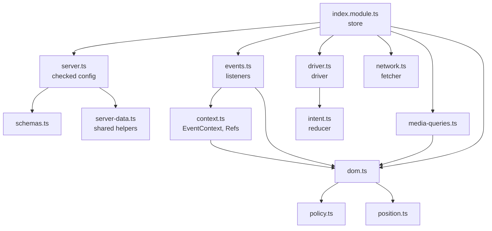
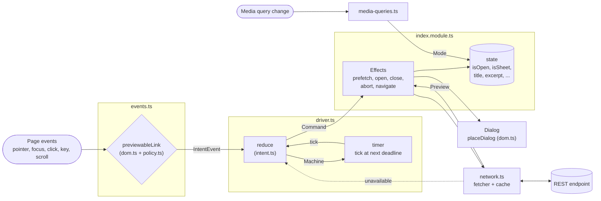
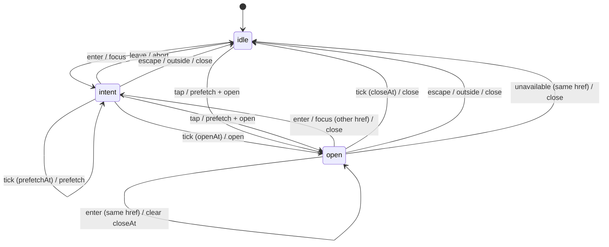
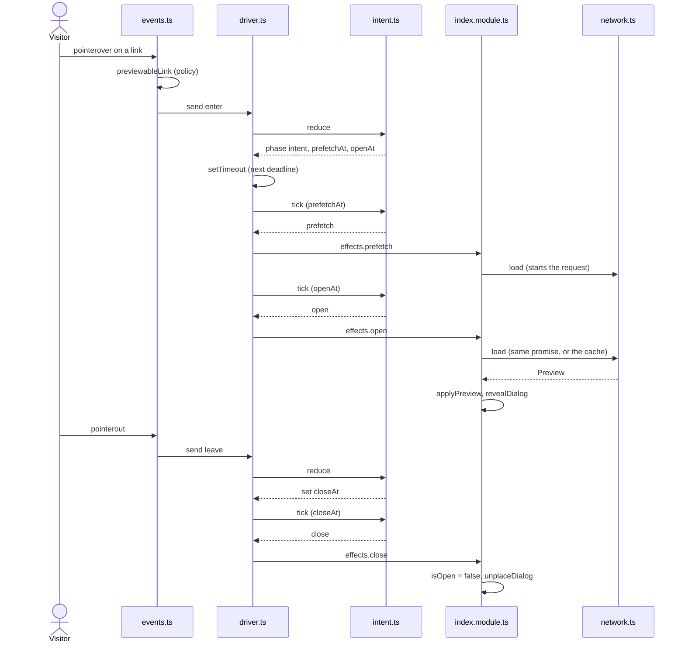

# Preview

The client preview shows a popover, or a sheet, with the preview of a link.
The code lives in `sources/client/preview/`. This document describes each
module and how the modules work together.

## Modes

The preview has three modes. `media-queries.ts` reads the mode from the
`sheetQuery` and `hoverQuery` values of the server configuration.

| Mode | Device | Behavior |
| --- | --- | --- |
| `hover` | fine pointer, wide window | A hover or a focus opens a popover next to the link. |
| `sheet` | coarse pointer | The first tap opens a sheet. A second tap on the same link navigates. |
| `off` | fine pointer, narrow window | The links keep their normal behavior. |

## Modules

| Module | Role | DOM | Side effects |
| --- | --- | --- | --- |
| `index.module.ts` | Entry point. Registers the `rinkukado` store and connects the other modules. | yes | yes |
| `events.ts` | Delegated listeners. Turns page events into intent events. | yes | sends events |
| `context.ts` | The `EventContext` and the `Refs` that the listeners share. | no | no |
| `driver.ts` | Runs the intent machine, its commands and its timer. | no | timer |
| `intent.ts` | The intent machine. A pure reducer. | no | no |
| `network.ts` | The fetcher. Requests, validates and caches the previews. | no | `fetch` |
| `policy.ts` | Decides if a link can show a preview. | no | no |
| `dom.ts` | DOM helpers: root, previewable link, mode, dialog placement. | yes | yes |
| `position.ts` | Computes the side and the position of the popover. | no | no |
| `media-queries.ts` | Reports the mode at the start and at each change. | no | listeners |
| `schemas.ts` | The Zod schemas of the config and the state from the server. | no | no |
| `server.ts` | Checks the server data one time, and gives the checked config. | no | no |
| `types.ts` | The shared types. The server types come from the schemas. | no | no |
| `style.scss` | The popover, the sheet and the custom properties. | — | — |

The pure modules (`intent.ts`, `policy.ts`, `position.ts`) have no DOM and no
timer. Jest tests them in `tests/unit/client/`.

## Dependencies

An arrow points from a module to the module that it imports. The diagram
leaves out `types.ts`, because it holds only types. `server-data.ts` belongs
to the shared helpers. See [Interactivity](interactivity.md).

## Server data

The server gives a config and a state to the store. The PHP side of this
data is in [Popover](../server/popover.md).

`schemas.ts` holds one strict schema for the config and one for the state.
Each schema holds exactly the keys that the server sends. `types.ts` takes
`ServerConfig`, `ServerState` and `Timings` from the schemas.

The first `init` calls `validateServerData()` of `server.ts`, before it
binds a listener or a media query:

1. It parses the config.
2. It parses the state, and writes the result into the state of the store.
3. It caches the config. `config()` then gives the cached config to the
   other modules.

If a parse fails, `init` reports the error with `reportError`, and returns.
The store binds nothing, so the links keep their normal behavior. The
console shows which key is wrong.

A later `init` does not parse again. A second parse would reset the state of
an open popover to the values of the server.

`config()` throws if a module calls it before the check.

## Data flow

The data moves in one direction. The listeners send events. The machine
returns commands. The store runs the commands and changes the state.

## Intent machine

`intent.ts` holds the machine. The machine has three phases and up to three
deadlines: `prefetchAt`, `openAt` and `closeAt`. The `timings` of the server
configuration set the deadlines. The driver sends a `tick` event when the
next deadline arrives.

## Sequence of a hover

This sequence shows the `hover` mode, from the pointer on the link to the
close of the popover.

## Rules of the design

- Only `driver.send` changes the machine. A transition never skips its
  commands or the timer that follows.
- The machine does not know the DOM, the network or the clock. Each event
  carries its own time in `at`.
- The fetcher keeps one request for each href. A second `load` call for the
  same href gets the same promise.
- The fetcher caches each settled result for the page session. An abort is
  not cached, so a later visit can try again.
- If the fetch fails after a tap, the store navigates to the link. The link
  keeps its normal behavior.
- The configuration (`ServerConfig`) does not change while the page is open.
  It stays out of the state.
- The store uses no server data before the check of `server.ts` passes.
